# Nexus Overseer

  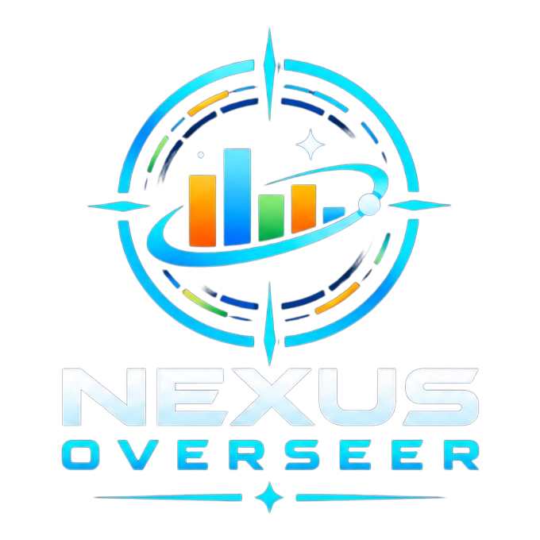

Browser extension (Firefox and Chrome) for [Nexus Legacy](https://nexuslegacy.space): statistics, mining, logistics and planning tools in one dashboard.

## Screenshots

All screenshots use the real dashboard with entirely fictional demo data.
No player account, actual coordinates or real economy data is shown.

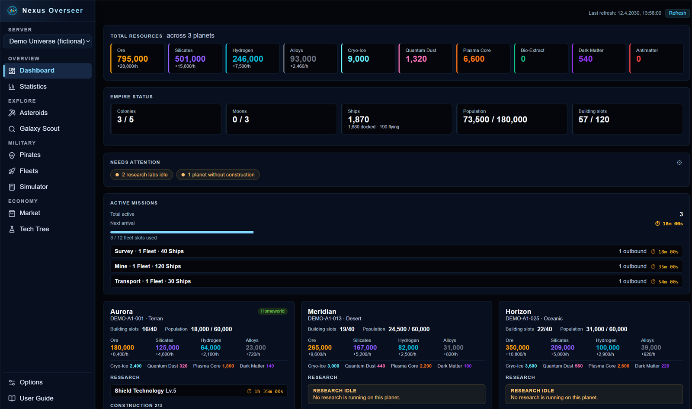

All screenshots: statistics, exploration, fleets, simulator, market and options

### Statistics

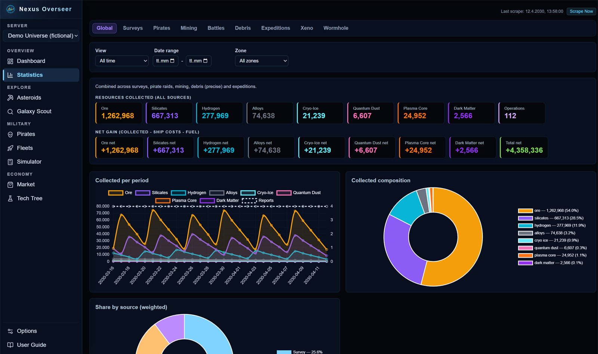

### Asteroid fields

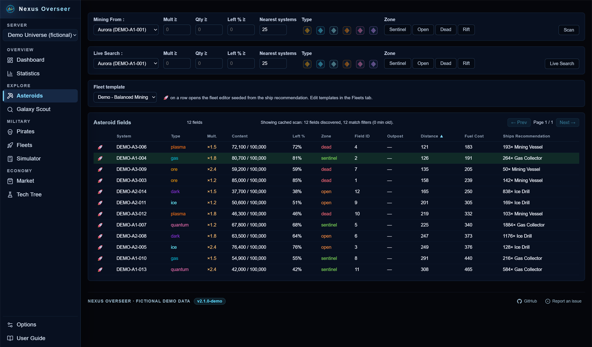

### Galaxy Scout

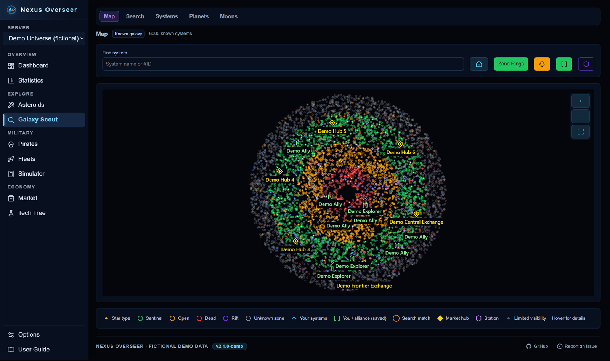

### Pirates

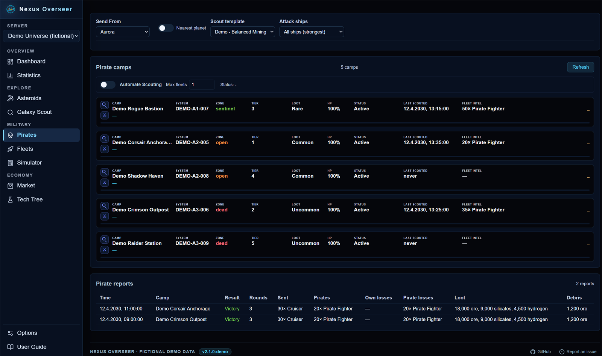

### Fleet templates

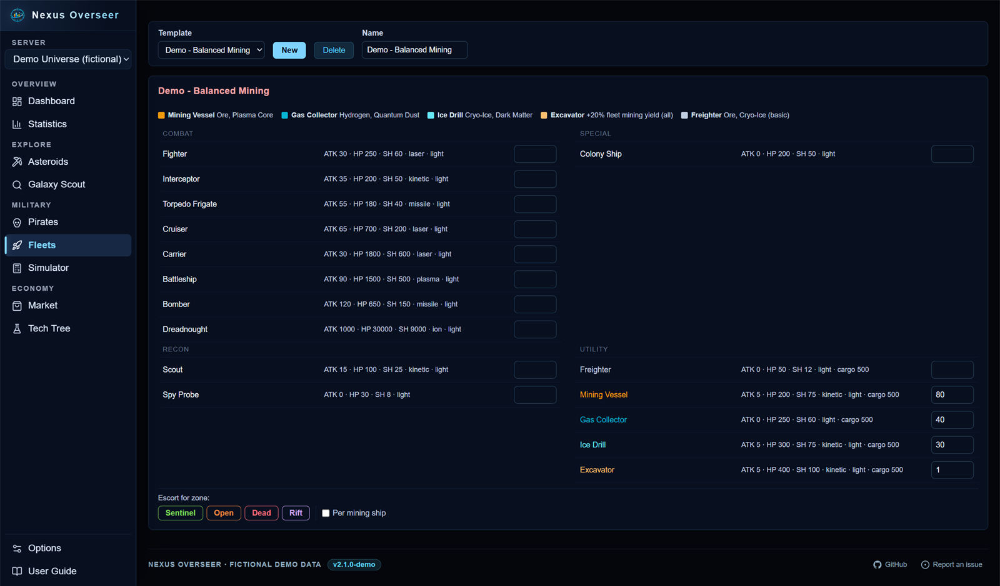

### Combat simulator

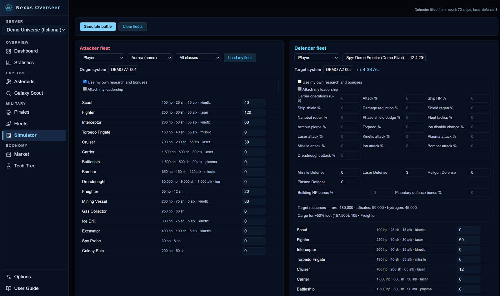

### Market

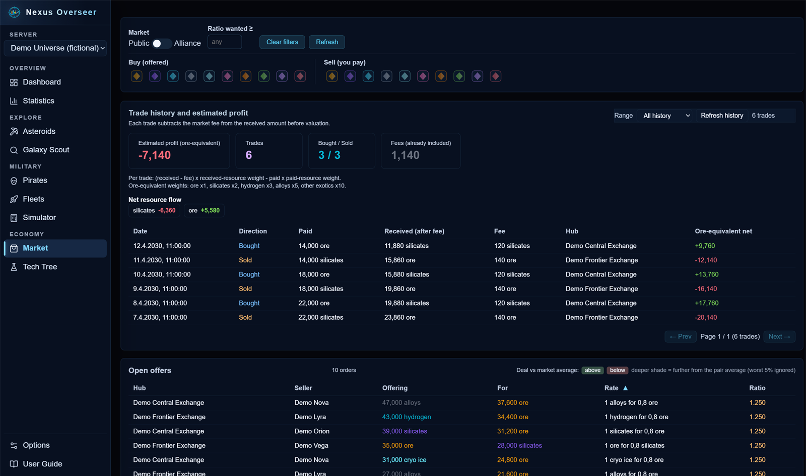

### Tech Tree

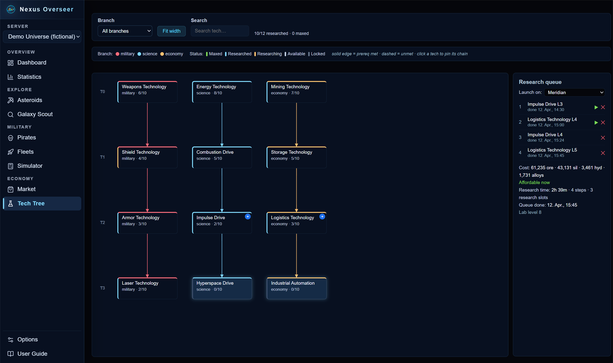

### Options

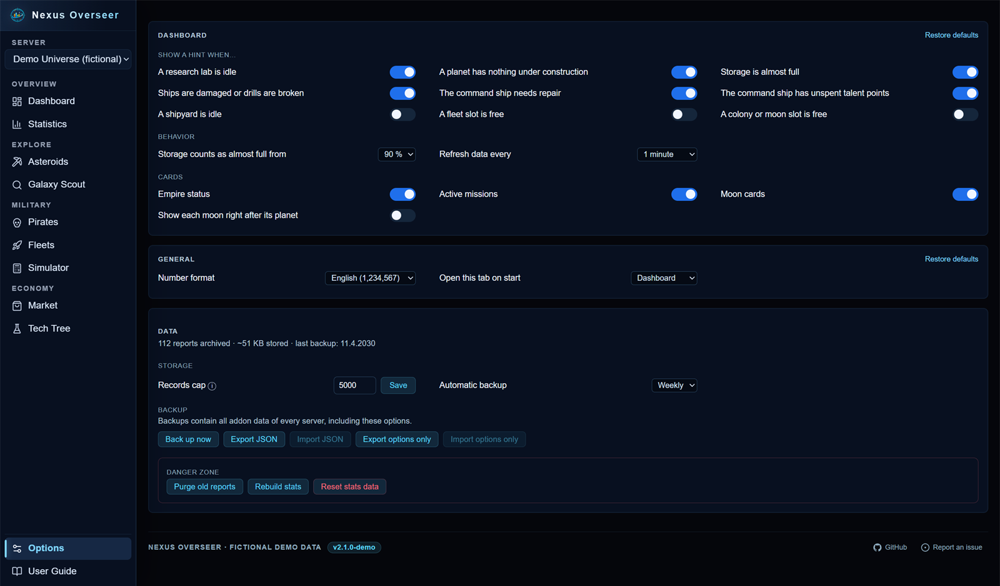

### User Guide

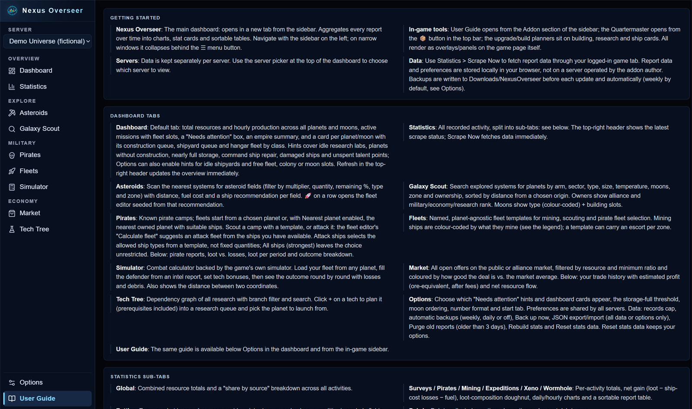

## Features

- **Dashboard**: default tab with total resources and hourly production across planets and moons, active missions, research, and per-colony queues and fleets.
- **Statistics**: survey, pirate, mining, battle, debris, expedition, xeno and wormhole reports with all-time, daily, hourly and yesterday views, charts and loss/rebuild costs.
- **Galaxy Scout**: scan systems and arms to find targets.
- **Asteroid Fields**: search by zone and resource type, start mining fleets, and use escort templates.
- **Fleet Templates**: reusable fleet compositions, including escort templates for mining.
- **Market**: browse and track trades.
- **Tech Tree and upgrades**: research overview plus building, ship and tech upgrade queues.
- **Logistics (Quartermaster)**: resource transfers and outpost collections with selectable transport ships.
- **Combat Simulator**: integrated directly into the dashboard, using the game's official combat calculator. Fleet inputs, intel imports, and battle results stay in the same tab.
- **Multiple universes**: data is kept separately for each universe.
- **Backups**: JSON export and import of your data and options (Options > Data).
- **Developer / Debug**: Options has General, Dashboard, Data and Developer / Debug subtabs in the same style as Statistics. Developer tools provide console log levels, a read-only resource history with UTC time buckets, and expandable API, galaxy-delta and WebSocket logs with search, copy, JSONL export and per-stream clearing.

### Diagnostic recording

Recording is **off by default** and separate from the console log level. Enable
it in **Options > Developer / Debug**, then use the game to capture new traffic.
Logs stay local and server-separated. Use JSONL export to keep them; regular
backups do not include diagnostic logs. Review exports for private game data
before sharing.

Capture behavior, storage limits and privacy details

Reload existing game tabs after updating or reloading the extension to ensure
diagnostic capture is active. Toggling recording on or off takes effect
immediately without reloading game tabs. Reloading also attaches capture to
new WebSocket connections. Only incoming text WebSocket frames are
recorded. Galaxy deltas are extracted from decoded `galaxy:delta` events.

**Galaxy Delta Updates** is a filtered diagnostic view of the WebSocket stream:
one incoming delta can appear in both lists without being received twice.
Capture is passive and only records events received while recording is enabled;
opening the map or selecting a system does not guarantee a delta event.
Observed `colonized` payloads contain `systemId` and `hasColonies: true`, but
do not identify a planet, owner or the number of colonies. Repeated identical
payloads can occur and must not be counted as distinct new colonies.
These logs do not currently update Galaxy Scout data or implement community
data sharing. Their timestamps indicate capture time, not a verified time of
the underlying game action.

Logs remain local and server-separated, with at most 150 entries per stream
and 10,000,000 UTF-8 bytes of entry JSON per server (excluding storage-container
overhead). Each sanitized entry allows 256,000 JSON characters. Oversized entries
retain API metadata and up to 100,000 serialized characters per body preview.
Capture reads up to 1,000,000 characters per payload; larger payloads are omitted
with a marker. Sanitization allows 100,000 characters per text value, 1,000 array
items or object fields per level, and nesting through depth 20. All these cuts
produce explicit truncation markers and mark the entry as truncated.
The page bridge batches at most 20
entries every 500 ms and discards excess entries. Disabling recording stops
new capture but keeps existing logs. Clear each stream independently of stats
and reports. Diagnostic traffic is stored separately in IndexedDB, using
incremental batched writes without storage-change broadcasts to game tabs.
Existing storage-based logs migrate on the next recorded batch or clear action.
Diagnostic logs are not included in regular data backups; use their JSONL export.
JSON detail views are generated only when expanded.

Headers, URL query strings and authentication endpoints are excluded.
Recognized secret fields and token patterns are redacted before data leaves
the page and again before storage. This is not a guarantee that arbitrary
payloads contain no personal information: review JSONL exports before sharing.
The Analytics panel derives its data from retained reports, fuel logs and mining
costs, independent of traffic recording. It is not a complete resource ledger
and cannot reconstruct deleted history or unrecorded expenses.

## How it works

The add-on sends requests through your logged-in game tab, and the browser attaches the game's HttpOnly session cookie. No credentials need to be entered.

Game data is stored locally in `browser.storage.local`. The add-on communicates
directly with the game API; it does not upload data to a server operated by the
add-on author.

## Installation

Download the latest package from the [Releases](https://github.com/DopeEx/NexusOverseer/releases) page:

- **Firefox**: the `.xpi` file
- **Chrome / Edge, manual installation on Windows**: the
  `nexus-overseer-<version>-windows-manual.zip` asset. Extract it to a permanent,
  writable folder, enable developer mode at `chrome://extensions` (Edge:
  `edge://extensions`), and load **only its `addon` subfolder** as an unpacked
  extension. Do not move that folder afterwards.
- **Other manual Chromium installations**: the plain `nexus-overseer-<version>.zip`
  contains only extension files, without the Windows updater.

### Windows manual updates

Double-click `Update-Nexus.bat` in the manual Windows package, then reload the
extension in your browser. No Git or Python installation is needed. Stable
releases are the default; testers can optionally select `master`.
The dashboard footer checks GitHub for stable releases when opened, at most
once every six hours, and links to a newer release. Master installations show
`dev` and their short commit; a GitHub commit comparison identifies builds
ahead of the latest release. The version button still opens What's new, grouped by release for the installed
minor-version series (for example, 2.2.2 through 2.2.0), newest first.
These checks apply only to manual Windows packages, not store packages.
Use **Check for updates** beside the footer version to check immediately,
without waiting for the six-hour cache. The button shows progress and the result;
manual checks have a 30-second click cooldown. Its tooltip shows the last check.

Update instructions, backups, troubleshooting and publishing

Double-click `Update-Nexus.bat` in the extracted manual package. No Git, Python,
Node.js or administrator access is normally needed; Windows PowerShell 5.1
(included with Windows 10/11) is required. The window stays open on completion
or failure. Managed devices may block scripts; system policies are not changed.

The default installs the latest **stable GitHub release**. Testers can explicitly
select **master**, with a warning and confirmation. The updater resolves a
specific commit before downloading it, and records the channel, revision and
installation time in `addon/.nexus-install.json`. Release remains the default
on every run, including after installing master. There is no automatic fallback
to a different channel.

Dashboard checks also cache failures for six hours; offline or rate-limited
checks are shown as unavailable, not as "up to date". An unavailable commit
comparison leaves the `dev` label in place without claiming the build is ahead.
A master commit behind the latest release triggers a release notice even if
the extension version numbers are equal. Builds ahead of or identical to the
release do not suggest installing that release as an update. These checks send
only public repository references to GitHub, never game data or credentials,
and do not run while the dashboard is closed. The plain Chromium/store ZIP
cannot distinguish a store upload from a manual installation; only the separate
Windows package and updater-managed installations enable these checks.

After updating, click **Reload** for the extension on the browser's extensions
page, then reload open game pages. **Do not uninstall the extension.** Keeping
the same loaded path preserves its identity; export data under **Options > Data**
before channel switches or downgrades. Older releases may not understand newer
data formats. File backups do **not** back up browser storage.

File backups and the error log are kept under `.update/backups` and
`.update/updater.log`. Backups are not automatically removed. Interrupted file
replacements are rolled back on the next start. A newer updater is offered
separately and **only from stable releases**, even when testing master.
If this later check or self-update fails after the add-on files were installed,
the updater reports a separate warning; the add-on update remains successful.
Self-updates require confirmation and take effect on the next launch. The small
protocol-1 batch starter is intentionally not self-updated: a future incompatible
starter requires re-extracting the manual package while retaining the loaded
`addon` path. SHA-256 checks detect damaged/mismatched payloads; they are not an
independent publisher signature.

For migration from an existing unpacked installation, retain the existing
extension directory and its exact path. If it is named `addon`, place the new
starter and `updater.ps1` in its parent directory. Otherwise a one-time
installation-path change and data export/import may be necessary. See
the included `Installation.txt` for recovery and migration instructions.

Store packages do not contain this updater. Firefox's signed/store installation
uses a different update mechanism; the Windows manual updater is for Chromium.

#### Building and publishing manual packages

`python nexus-addon/build.py --manual` builds only the Windows manual ZIP;
the normal build also generates it alongside both store payloads. The release
workflow attaches all three assets and first runs the Windows updater tests.
The latest stable release must contain the new `*-windows-manual.zip` asset
before release updates or updater checks can work. Older releases are not
retroactively changed. A missing asset is reported explicitly; it never causes
an automatic switch to master.

The shared file list in `tools/windows-updater/addon-files.json` controls both
store packaging and which files a master update copies. When adding extension
files, update that list. Increment `$script:UpdaterVersion` in
`tools/windows-updater/updater.ps1` for updater changes that existing users
should receive. Publish them in a new stable release. Protocol-1 starters
expect a single replaceable `updater.ps1` and the documented recovery markers;
incompatible changes require a new launcher protocol and manual migration.
Use `Update-Nexus.bat` from the Windows manual package for the supported
manual update workflow.

## Usage

1. Log in to [Nexus Legacy](https://nexuslegacy.space)
2. Click the Nexus Overseer toolbar icon to open the dashboard
3. Use **Scrape Now** to fetch data immediately

## Documentation

- [Local screenshot demo](docs/screenshot-demo.md): run the dashboard with fictional data, without a game account.
- [API integration reference](docs/api-reference.md): API routes used by the add-on, request handling, and observed response shapes.
- [Game reference](docs/game-reference.md): game systems and reference data.
- [Privacy policy](docs/privacy-policy.md): data access, storage, and API actions.
- [Changelog](nexus-addon/CHANGELOG.md)

## License

[Mozilla Public License 2.0](https://www.mozilla.org/en-US/MPL/2.0/)

## Origin

This project started as a fork of [Verroq/NexusAccounting](https://github.com/Verroq/NexusAccounting)
and has since been developed independently. See [NOTICE.md](NOTICE.md) for copyright and attribution details.
